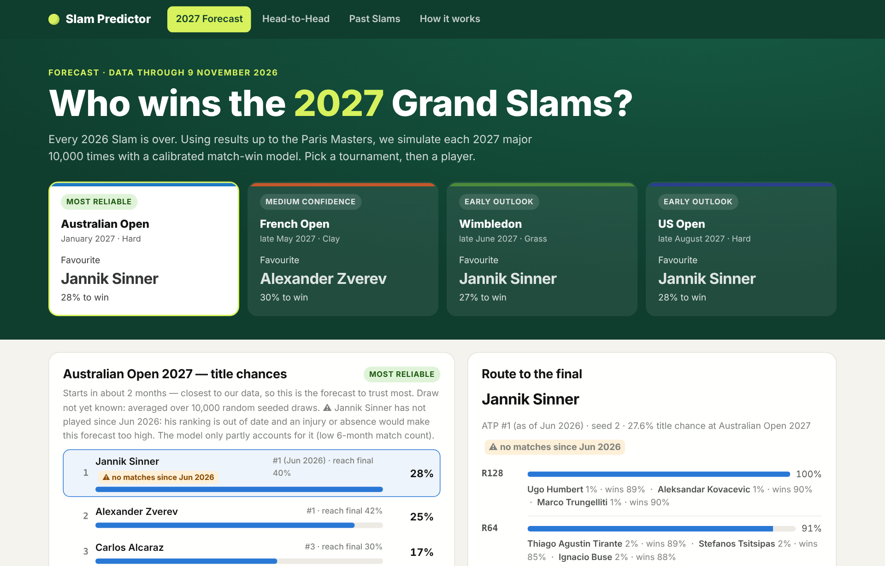
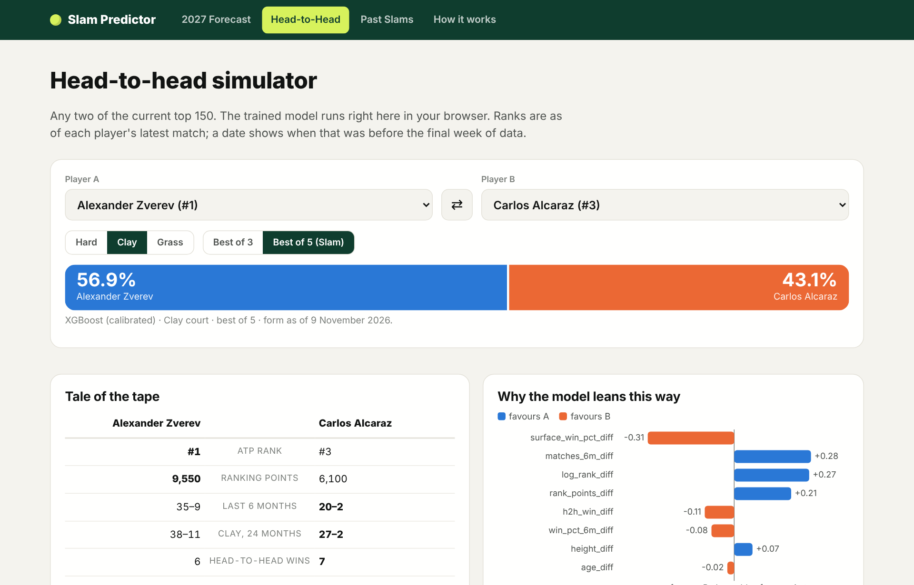
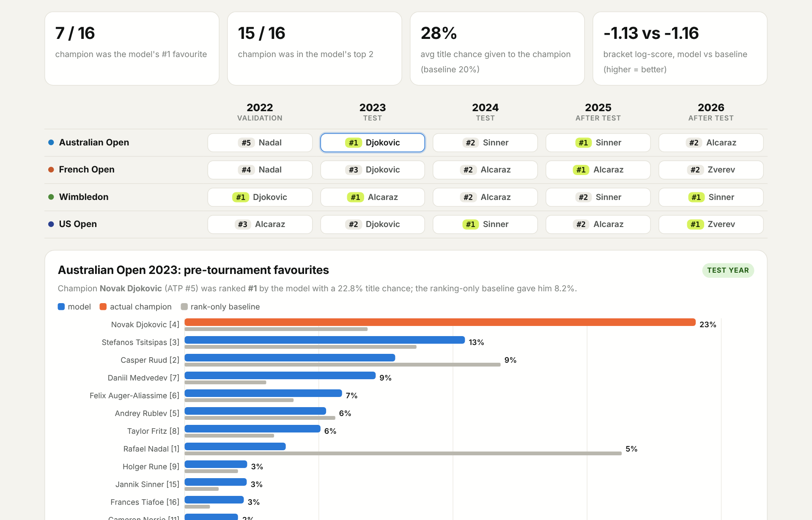
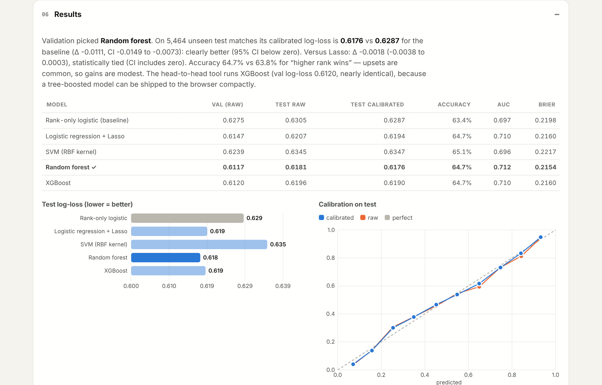

# 🎾 Slam Predictor: Who Wins the 2027 Grand Slams?

[](https://kshitijkasodkar.github.io/Tennis-Slam-Predictor/)
[](https://www.python.org/)
[](https://scikit-learn.org/)
[](https://xgboost.readthedocs.io/)
[](#-models)
[](#-data)
[](#-how-it-works)
[](https://opensource.org/licenses/MIT)

**Slam Predictor** is an interactive website that forecasts the **2027 tennis Grand Slams**. A calibrated machine-learning model estimates who wins each ATP match from pre-match information only, and every Grand Slam is then simulated **10,000 times** to turn match odds into **title odds** and a **route to the final** for every player. All of this comes from ATP results up to **9 November 2026**.

---

## 🌐 Live Demo

👉 **Live here:** https://kshitijkasodkar.github.io/Tennis-Slam-Predictor/

No installation required. The site is fully static (GitHub Pages) and the trained model runs **inside your browser**.

| 2027 Forecast | Head-to-Head |
|---|---|
|  |  |

| Past Slams | How it Works |
|---|---|
|  |  |

---

## 🎓 Course & Project Information

- **Course:** ES 335: Machine Learning
- **Institute:** Indian Institute of Technology Gandhinagar
- **Deliverable:** interactive project website on GitHub Pages + source repository

### 👥 Team Members

| Roll Number | Name | Contact Email |
|:---:|---|---|
| **23110175** | Kshitij Kasodkar | `kshitij.kasodkar@iitgn.ac.in` |
| **23110043** | Arnav Gogate | `arnav.gogate@iitgn.ac.in` |

---

## 🚀 Overview

Every 2026 Grand Slam is over. **Who wins in 2027?**

> 💡 **Research question:** from pre-match information only, how well can we estimate who wins an ATP match, and each player's chance of winning a Grand Slam, and does this beat simply trusting the ATP rankings?

The project works in two steps:

1. **Match level:** for any two players, predict a **calibrated** win probability from ranking, recent form, surface record, head-to-head, age and height.
2. **Tournament level:** play the 128-player draw **10,000 times** with those probabilities (Monte Carlo) to get each player's chance of winning the title and of reaching every round.

The same pipeline is first **backtested on all 20 Grand Slams from 2022 to 2026**, each predicted before round 1 with the real draw. It is then used to forecast the four 2027 majors.

---

## ✨ Features

### 🔮 2027 Forecast
* Title chances for the **Australian Open, French Open, Wimbledon and US Open 2027**.
* A **confidence label** on each: the Australian Open (about 2 months away) is the most reliable; Wimbledon and the US Open are early outlooks.
* **Route to the final:** click any player to see his chance of reaching each round, his most likely opponents, and his win chance against each.
* **Season heat-map** comparing the top contenders across all four Slams.

### ⚔️ Head-to-Head Simulator
* Pick any two of the **top 150** players, a **surface** (hard, clay, grass) and **best of 3 or 5**.
* Get a live, calibrated win probability, computed in your browser.
* **Tale of the tape** (rank, form, surface record, head-to-head) and **why the model leans that way** (per-feature contributions).

### 📅 Past Slams
* A grid of every Grand Slam from **2022 to 2026**, showing the champion and where the model ranked him **before round 1**.
* Click any tournament to compare the model with a ranking-only baseline.

### 📖 How it Works
* A short **FAQ** plus the full method: question, data, preprocessing, models, evaluation, results, errors, limitations and conclusion.

---

## 🧠 How It Works

```
ATP match results (2008 – 9 Nov 2026)
        ↓
Clean: tour-level matches only, ordered by date → event → round
        ↓
Features from earlier matches only (Player A − Player B):
  ranking · ranking points · 6-month form · surface win rate · head-to-head · age · height
        ↓
Train 2010–2021  →  tune with TimeSeriesSplit
        ↓
Validate on 2022  →  choose the model + calibrate probabilities
        ↓
Test once on 2023–2024
        ↓
Simulate each Grand Slam 10,000 times
  past Slams → real draws  ·  2027 Slams → random seeded draws
        ↓
Website (static JSON + model running in JavaScript)
```

* **No data leakage:** every feature for a match uses only matches played *before* it.
* **Calibrated:** when the model says 70 %, that player wins about 70 % of the time (checked on the test set).
* **Fair labels:** Player A and Player B are assigned by a coin flip, so the model can't learn "the winner is listed first".

---

## 🤖 Models

| Model | Role | Why it was used |
|---|---|---|
| **Rank-only logistic regression** | Baseline | what a fan already knows: "the better-ranked player usually wins" |
| **Logistic Regression + Lasso** | Candidate | simple, interpretable, removes weak features |
| **SVM (RBF kernel)** | Candidate | non-linear decision boundary |
| **Random Forest** | ✅ **Selected** | best validation score; learns interactions such as form × surface |
| **XGBoost** | Candidate · **powers the website's head-to-head tool** | statistically tied with Random Forest and small enough to run in the browser |

The model was chosen by **validation log-loss**, fixed before looking at the test set.

---

## 📊 Results

| Metric | Rank-only baseline | Our model |
|---|:-:|:-:|
| Match log-loss, 2023–24 test (lower = better) | 0.629 | **0.618** |
| Match accuracy, 2023–24 test | 63.8 % | **64.7 %** |
| Avg. title chance given to the eventual champion (16 held-out Slams) | 20 % | **28 %** |
| Champion in the model's top 2 before round 1 | n/a | **15 of 16** |

* The improvement over the ranking-only baseline is **statistically significant** (95 % bootstrap CI excludes zero).
* Accuracy gains are modest by nature: tennis has many upsets, and close matches are near coin flips.
* **Not just the rankings:** at the 2023 Australian Open, Djokovic was ranked #5, but the model made him favourite (23 % vs 8 % for the baseline). He won.

### 🏆 2027 Forecast

| Slam | Favourite | 2nd | 3rd |
|---|---|---|---|
| 🇦🇺 Australian Open | **Sinner 28 %** | Zverev 25 % | Alcaraz 17 % |
| 🇫🇷 French Open | **Zverev 30 %** | Sinner 25 % | Alcaraz 19 % |
| 🇬🇧 Wimbledon | **Sinner 27 %** | Zverev 25 % | Alcaraz 18 % |
| 🇺🇸 US Open | **Sinner 28 %** | Zverev 24 % | Alcaraz 18 % |

> ⚠️ The data has **no Sinner matches after Wimbledon 2026**, so his ranking in our data is out of date. The site flags this; if he is injured, his forecasts are too high.

---

## 📦 Data

ATP match results from the **[TennisMyLife (TML) database](https://stats.tennismylife.org/tennis-match-database)**, which keeps Jeff Sackmann's `atp_matches` format up to date from official ATP results.

* **Coverage:** 2008 to 9 November 2026 (Paris Masters final), **49,703** tour-level matches.
* **Kept:** Grand Slams, Masters 1000, ATP 500/250, Tour Finals, Olympics. Davis Cup is excluded.
* **Terms:** educational, non-commercial use. The raw CSV files are **not included** in this repository.

---

## ⚙️ Run Locally

### 1. Get the data
Download https://stats.tennismylife.org/api/download-all and copy `2008.csv` … `2026.csv` into `data/raw/`.

### 2. Install
```bash
python3 -m venv ~/venvs/tennis
source ~/venvs/tennis/bin/activate
pip install -r requirements.txt
```

### 3. Rebuild everything (~2 minutes)
```bash
python -m src.features      # features from earlier matches only
python -m src.train         # tune → select → calibrate → test once
python -m src.simulate      # past Slams on real draws + 2027 forecasts
python -m src.export_site   # data files for the website
```

### 4. View the site
```bash
python -m http.server -d docs 8000      # open http://localhost:8000
```
or click **Go Live** in VS Code (the repo already points it at `docs/`).

---

## 📂 Project Structure

```text
Tennis-Slam-Predictor/
│── src/
│   ├── features.py       # Load matches, build leakage-safe features
│   ├── train.py          # Tune, select, calibrate and test the models
│   ├── simulate.py       # Monte Carlo on real draws + 2027 forecasts
│   ├── export_site.py    # Export results and the model for the website
│   ├── calib.py          # Probability calibration
│   └── config.py         # Paths, year splits, feature list
│── scripts/
│   └── verify_js_model.py  # Checks the browser model matches Python
│── docs/                 # 🌐 The website (GitHub Pages)
│   ├── index.html
│   ├── css/  js/  data/  img/
│── data/raw/             # ATP CSVs go here (not committed)
│── requirements.txt
│── README.md
```

---

## 🚧 Limitations & Future Scope

* **Forecast horizon:** player form is frozen at 9 November 2026, so later 2027 Slams are less reliable.
* **Unknown draws:** 2027 draws are not published yet, so each simulation uses a random seeded draw.
* **Missing context:** injuries, withdrawals and motivation are not in the data.
* **Rankings:** each rank is "as of the player's last match", so inactive players keep older ranks.

**Future scope:** 🔄 re-run before each Slam with the real draw · 📈 Elo ratings and serve/return statistics as features · 👩 WTA tour · 📊 live updates during a tournament.

---

## 🤖 AI-Use Disclosure

We used **Claude (Anthropic)** for brainstorming, code scaffolding, debugging, website layout and editing text. We reviewed the code, re-ran the full pipeline ourselves, and checked the key outputs independently. We are responsible for every result.

---

## 📚 References

1. TennisMyLife ATP database: https://stats.tennismylife.org/tennis-match-database
2. L. Breiman, "Random Forests," *Machine Learning*, 2001.
3. T. Chen, C. Guestrin, "XGBoost: A Scalable Tree Boosting System," *KDD*, 2016.
4. J. Platt, "Probabilistic Outputs for Support Vector Machines," 1999.
5. F. Pedregosa et al., "Scikit-learn: Machine Learning in Python," *JMLR*, 2011.

---

## 📄 License

This project is licensed under the **MIT License**: see [`LICENSE`](https://opensource.org/licenses/MIT).

---

## 👨‍💻 Authors

**Kshitij Kasodkar**

B.Tech

Dual Major in Materials Engineering and Computer Science Engineering

Indian Institute of Technology Gandhinagar

GitHub:
https://github.com/KshitijKasodkar

**Arnav Gogate**

B.Tech in Mechanical Engineering

Indian Institute of Technology Gandhinagar

---
