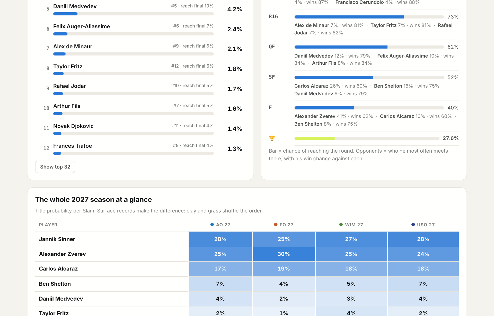

# 🎾 Slam Predictor: Who Wins the 2027 Grand Slams?

<p align="center">

[](https://kshitijkasodkar.github.io/Tennis-Slam-Predictor/)


[](https://opensource.org/licenses/MIT)

</p>

<p align="center">

### 🏆 Calibrated match-win models + 10,000 Monte Carlo simulations per tournament, predicting every 2027 Grand Slam from ATP data up to 9 November 2026

</p>

<p align="center"></p>

---

## 🌐 Live Demo

👉 **Live here:** https://kshitijkasodkar.github.io/Tennis-Slam-Predictor/

No installation required. The site is fully static (GitHub Pages) and the trained model runs **inside your browser**.

---

## 🎓 Course & Project Information

- **Course:** ES 335: Machine Learning (undergraduate track)
- **Institute:** Indian Institute of Technology Gandhinagar
- **Deliverable:** interactive project website on GitHub Pages + source repository

### 👥 Team Members

| Roll Number | Name | Contact Email |
|:---:|---|---|
| **23110043** | Arnav Gogate | `<add email>` |
| **23110175** | Kshitij Kasodkar | `kshitij.kasodkar@iitgn.ac.in` |

---

## 📸 Demo

| 2027 Forecast | Season at a Glance |
|------|----------------|
|  |  |

| Head-to-Head Simulator | Past Slams: Was the Model Right? |
|------|----------------|
|  |  |

| How it Works: Results & Calibration |
|------|
|  |

---

## 📚 Table of Contents

1. [Overview](#-overview)
2. [Key Highlights](#-key-highlights)
3. [2027 Forecast](#-2027-forecast)
4. [Website Features](#-website-features)
5. [How It Works](#-how-it-works)
6. [Data](#-data)
7. [Features (Model Inputs)](#-features-model-inputs)
8. [Models & Evaluation Design](#-models--evaluation-design)
9. [Results](#-results)
10. [Was the Model Right? Past Slams](#-was-the-model-right-past-slams)
11. [Changes from the Proposal](#-changes-from-the-proposal)
12. [Quickstart: Rebuild Everything](#-quickstart-rebuild-everything)
13. [Repository Structure](#-repository-structure)
14. [Limitations & Future Scope](#-limitations--future-scope)
15. [Troubleshooting](#%EF%B8%8F-troubleshooting)
16. [AI-Use Disclosure](#-ai-use-disclosure)
17. [References](#-references)

---

## 🚀 Overview

Every 2026 Grand Slam is over. **Who wins in 2027?**

This project answers that in two steps:

1. **Match level:** for any two players, estimate a **calibrated** probability that each one wins, using only information available *before* the match: ranking, recent form, surface record, head-to-head, age and height.
2. **Tournament level:** play each Grand Slam's 128-player draw **10,000 times** with those match probabilities (Monte Carlo) to turn match odds into **title odds** and a **route to the final** for every player.

The same pipeline is first **backtested** on the 20 Grand Slams from 2022 to 2026, predicting each one before round 1 with the real draw and nothing from the tournament itself. It is then used to forecast the four 2027 majors.

> 💡 **The research question:** from pre-match information only, how well can we estimate who wins an ATP match and each player's chance of winning a Grand Slam, and does this beat simply trusting the rankings?

---

## 🌟 Key Highlights

- 🔮 **2027 forecasts** for the Australian Open, French Open, Wimbledon and US Open, each with a **confidence label** based on how far ahead it is.
- 🎯 **Beats the rankings:** test log-loss **0.6176 vs 0.6287** for a ranking-only baseline (95 % CI of the gain: −0.0149 to −0.0073).
- 🏆 **Strong on real tournaments:** across 16 held-out Slams the eventual champion was in the model's **top 2 in 15 of 16**, and received **28 %** title probability on average (ranking-only: 20 %).
- 🧪 **Leakage-safe by construction:** one chronological pass; every feature is read *before* the match result is written.
- 📏 **Honest evaluation:** tuned with `TimeSeriesSplit` on 2010–2021, selected on 2022, tested **once** on 2023–2024.
- 🎚️ **Calibrated probabilities:** Platt scaling, checked with a reliability curve. When the model says 70 %, that player wins about 70 % of the time.
- 🌍 **Model in the browser:** the XGBoost trees are exported to JSON and evaluated in JavaScript, matching Python to **~1e-7**.
- 🗺️ **Real draws rebuilt** from match results for every past Slam, verified against every first-round pair.

---

## 🔮 2027 Forecast

Data up to **9 November 2026** (Paris Masters final). Title probability from 10,000 simulated draws (top 32 seeded):

| Slam | Confidence | 🥇 Favourite | 🥈 | 🥉 | 4th |
|---|:-:|---|---|---|---|
| 🇦🇺 **Australian Open** (Jan) | 🟢 Most reliable | Sinner **27.6 %** | Zverev 24.9 % | Alcaraz 17.4 % | Shelton 6.5 % |
| 🇫🇷 **French Open** (May) | 🟡 Medium | Zverev **30.4 %** | Sinner 24.9 % | Alcaraz 18.9 % | Shelton 3.7 % |
| 🇬🇧 **Wimbledon** (Jun–Jul) | ⚪ Early outlook | Sinner **26.8 %** | Zverev 25.1 % | Alcaraz 17.6 % | Shelton 5.0 % |
| 🇺🇸 **US Open** (Aug–Sep) | ⚪ Early outlook | Sinner **28.4 %** | Zverev 24.1 % | Alcaraz 18.2 % | Shelton 6.5 % |

> ⚠️ **Caveat:** the data has **no Sinner matches after Wimbledon 2026**, so his ranking in our snapshot is out of date. The site flags this (⚠). If he is injured, his forecasts are too high. The model only partly accounts for it through its low "matches in the last 6 months" feature.

---

## ✨ Website Features

### 🔮 2027 Forecast
- Four tournament cards with the favourite and a **confidence badge** (horizon ≈ 2 / 6 / 8 / 9 months)
- Title chances for the top 12 / 32 contenders, with chance of reaching the final
- **Route to the final:** click any player to see his chance of reaching each round, his most likely opponents and his win chance against each
- **Season heat-map:** title odds for the top players across all four 2027 Slams

### ⚔️ Head-to-Head Simulator
- Any two of the current top 150 · **Hard / Clay / Grass** · **Best of 3 / Best of 5**
- Calibrated win probability computed live in the browser
- **Tale of the tape:** rank, points, 6-month record, surface record, head-to-head, age, height
- **"Why the model leans this way":** per-feature contribution to the log-odds (tree-path attribution)

### 📅 Past Slams
- A **Slam × year grid (2022–2026)**: each cell shows the champion and where the model ranked him before round 1
- Click any cell: model vs ranking-only baseline for the top contenders, champion highlighted

### 📖 How It Works
- FAQ plus every rubric section: question, data, preprocessing, methods, evaluation, results, errors, limitations, conclusion, reproduction, AI use, all collapsible

---

## 🧠 How It Works

```
ATP match results 2008 – Nov 2026 (TennisMyLife, Sackmann format)
                     ↓
Clean: tour-level only · drop walkovers · order by date → event → round
                     ↓
One chronological pass over 49,703 matches
  read features from player history  →  THEN  write the result
                     ↓
Differential features (Player A − Player B), coin-flip A/B
                     ↓
Train 2010–2021  →  tune with TimeSeriesSplit
                     ↓
Validate 2022    →  select model + fit Platt calibration
                     ↓
Test 2023–2024   →  scored once
                     ↓
Symmetric pairwise matrix  P[i,j] = (p(i,j) + 1 − p(j,i)) / 2
                     ↓
Monte Carlo: 10,000 brackets per Slam
  past Slams → real draws rebuilt from results
  2027 Slams → random draws, top 32 on seed lines
                     ↓
JSON export  →  static website (model also runs in JavaScript)
```

---

## 📦 Data

| Item | Details |
|---|---|
| **Source** | [TennisMyLife (TML) ATP database](https://stats.tennismylife.org/tennis-match-database): ATP results in Jeff Sackmann's `atp_matches` format, updated from official ATP data |
| **Download** | https://stats.tennismylife.org/api/download-all → use `2008.csv` … `2026.csv` |
| **Coverage** | 2008 – **9 Nov 2026** (2008–09 used only as warm-up history) |
| **One raw row** | one completed match: winner, loser, ranks, points, age, height, surface, round, score |
| **Kept** | Grand Slams, Masters 1000, ATP 500 / 250, Tour Finals, Olympics (Davis Cup excluded) |
| **Size** | 49,703 tour-level matches · 322 walkovers (kept only to rebuild draws) · 1,546 retirements (in history, not scored) |
| **Terms** | Personal / educational, non-commercial use; **raw CSVs are not redistributed** (git-ignored) |

> 🔁 We started with an archive of Sackmann's `tennis_atp` data, which ends in May 2026. We switched to TML (same format) to reach November 2026 and forecast 2027. Player IDs differ between the two, so the sources are never mixed.

---

## 🧮 Features (Model Inputs)

All features are **Player A − Player B**, computed only from matches **before** the current one.

| Feature | Meaning |
|---|---|
| `log_rank_diff` | log(rank A) − log(rank B): #1 vs #10 matters far more than #101 vs #110 |
| `rank_points_diff` | ATP ranking points gap |
| `win_pct_6m_diff` | win rate over the last 6 months (shrunk toward 50 %) |
| `matches_6m_diff` | matches played in the last 6 months (activity / fitness proxy) |
| `surface_win_pct_diff` | win rate on this surface over the last 24 months (shrunk) |
| `h2h_win_diff` | previous head-to-head wins |
| `age_diff`, `height_diff` | physical differences |
| `best_of_5`, `surface_clay`, `surface_grass` | context flags, so trees can learn interactions |

- 🧷 **Shrinkage:** win rate = (wins + 2.5) / (matches + 5), so a 2–0 record isn't "100 %".
- 🪙 **Symmetric framing:** a seeded coin decides who is "A", so labels are balanced and every feature flips sign with the label.
- 🚰 **No leakage:** imputation and scaling live inside scikit-learn pipelines, fitted on training folds only.

---

## 🤖 Models & Evaluation Design

| Model | Role | Why |
|---|---|---|
| **Rank-only logistic** | Baseline | what a fan already knows; every model must beat it |
| **Logistic regression + Lasso** | Candidate | additive log-odds, interpretable, L1 drops weak features |
| **SVM (RBF kernel)** | Candidate | non-linear margin; trained on the latest 12k rows (O(n²)) |
| **Random forest** | Candidate · **selected** | bagged trees, learns interactions (form × surface) |
| **XGBoost** | Candidate · **powers the browser tool** | boosted trees; compact enough to ship to JavaScript |

| Split | Years | Matches | Used for |
|---|---|:-:|---|
| 🟦 Train | 2010 – 2021 | 29,437 | fitting + 4-fold `TimeSeriesSplit` tuning |
| 🟩 Validation | 2022 | 2,623 | model selection + Platt calibration |
| 🟧 Test | 2023 – 2024 | 5,464 | **scored once**, after everything was frozen |
| ⬜ Later | 2025 – 2026 Slams | n/a | extra out-of-sample tournament checks |

**Metrics:**
- **Log-loss (primary):** title odds multiply about 7 match probabilities, so probability quality matters more than picking winners.
- **Secondary:** accuracy, ROC-AUC and Brier score.
- **Checks:** reliability curve and paired bootstrap 95 % CI.
- **Tournament level:** probability given to the real champion, and a bracket log-score.

---

## 📊 Results

### Match level: test seasons 2023–2024 (5,464 matches)

| Model | Val log-loss | Test log-loss (raw) | Test log-loss (calibrated) | Accuracy | ROC-AUC | Brier |
|---|:-:|:-:|:-:|:-:|:-:|:-:|
| Rank-only logistic (baseline) | 0.6275 | 0.6305 | 0.6287 | 63.4 % | 0.697 | 0.2198 |
| Logistic regression + Lasso | 0.6147 | 0.6207 | 0.6194 | 64.7 % | 0.710 | 0.2160 |
| SVM (RBF kernel) | 0.6239 | 0.6345 | 0.6347 | 65.1 % | 0.696 | 0.2217 |
| **Random forest ✓** | **0.6117** | **0.6181** | **0.6176** | **64.7 %** | **0.712** | **0.2154** |
| XGBoost | 0.6120 | 0.6196 | 0.6190 | 64.7 % | 0.710 | 0.2160 |

- ✅ **vs baseline:** Δ log-loss **−0.0111** (95 % CI −0.0149 to −0.0073): a clear improvement.
- 🤝 **vs Lasso:** Δ −0.0018 (CI −0.0038 to +0.0003): **statistically tied**, so the signal is mostly additive.
- 🎯 "Higher-ranked player wins" gets 63.8 %. Upsets are common in tennis, so accuracy gains are modest by nature.

### Where the model struggles

| Group | Matches | Accuracy | Log-loss | Baseline |
|---|:-:|:-:|:-:|:-:|
| Grand Slams | 983 | **72.1 %** | 0.539 | 0.560 |
| Other tour-level | 4,481 | 63.1 % | 0.635 | 0.644 |
| Similar rank (< 1.6×) | 1,512 | 56.4 % | 0.681 | 0.691 |
| Big rank gap (> 7.4×) | 999 | 81.7 % | 0.451 | 0.470 |

**Most important features** (permutation importance on validation): `log_rank_diff` → `surface_win_pct_diff` → `rank_points_diff` → `win_pct_6m_diff` → `matches_6m_diff`.

---

## 📅 Was the Model Right? Past Slams

Predicted **before round 1** with the real draw. The number is where the eventual champion sat in the model's ranking.

| Slam | 2022 *(val)* | 2023 | 2024 | 2025 | 2026 |
|---|:-:|:-:|:-:|:-:|:-:|
| 🇦🇺 Australian Open | #5 Nadal | **#1 Djokovic** | #2 Sinner | **#1 Sinner** | #2 Alcaraz |
| 🇫🇷 French Open | #4 Nadal | #3 Djokovic | #2 Alcaraz | **#1 Alcaraz** | #2 Zverev |
| 🇬🇧 Wimbledon | **#1 Djokovic** | **#1 Alcaraz** | #2 Alcaraz | #2 Sinner | **#1 Sinner** |
| 🇺🇸 US Open | #3 Alcaraz | #2 Djokovic | **#1 Sinner** | #2 Alcaraz | **#1 Zverev** |

| Held-out Slams (2023 → US Open 2026) | Model | Ranking-only |
|---|:-:|:-:|
| Champion was the #1 favourite | **7 / 16** | n/a |
| Champion in the top 2 | **15 / 16** | n/a |
| Average title probability given to the champion | **28 %** | 20 % |
| Bracket log-score (higher = better) | **−1.13** | −1.16 |

> 🧠 **Not just the rankings:** at the 2023 Australian Open, Djokovic was ranked **#5**, but the model made him favourite at **22.8 %** (baseline 8.2 %). He won.

---

## 🔁 Changes from the Proposal

| # | Proposal | Final project | Why |
|:-:|---|---|---|
| 1 | Baseline: Logistic Regression + Lasso | Kept, **plus** a simpler rank-only baseline | a baseline should be the simplest sensible rule |
| 2 | XGBoost as main method | **Random forest selected**; XGBoost tied and powers the browser tool | the rule fixed in advance was "best validation log-loss" |
| 3 | `rank_diff` | `log_rank_diff` | rank gaps matter much more at the top |
| 4 | Surface win % over 12–24 months | 24 months, with shrinkage | stable estimates for small samples |
| 5 | 1,000 Monte Carlo simulations | **10,000** | Monte Carlo error ≤ 0.5 percentage points |
| 6 | Route to final on "the selected draw" | Real draws for past Slams; random seeded draws for 2027 | 2027 draws do not exist yet |
| 7 | ATP dataset (Sackmann) | TennisMyLife (same format, updated) | needed data up to Nov 2026 |
| 8 | Matplotlib for plots | Charts drawn in the website (SVG) | the deliverable is an interactive site |

Unchanged from the proposal: the question, row definition, symmetric target, features, SVM/RF/XGBoost, the 2010–21 / 2022 / 2023–24 split, `TimeSeriesSplit`, log-loss primary with accuracy and AUC secondary, leakage control, sigmoid calibration, the Monte Carlo design and all three dashboard interactions.

---

## ⚡ Quickstart: Rebuild Everything

### 1. Get the data
Download https://stats.tennismylife.org/api/download-all and copy `2008.csv` … `2026.csv` into `data/raw/`.

### 2. Environment
```bash
python3 -m venv ~/venvs/tennis
source ~/venvs/tennis/bin/activate
pip install -r requirements.txt
```

### 3. Run the pipeline
```bash
python -m src.features      # ~5 s   chronological features + pre-tournament snapshots
python -m src.train         # ~1.5 m tune → select → calibrate → test once
python -m src.simulate      # ~15 s  past Slams on real draws + 2027 forecasts
python -m src.export_site   #        JSON for the website (docs/data)
python scripts/verify_js_model.py   # optional (Node.js): browser model == Python model
```

**Expected:** `loaded 49703 tour-level matches` · `selected: rf` · four `projection:` lines for 2027.

### 4. View the site
```bash
python -m http.server -d docs 8000      # → http://localhost:8000
```
or use VS Code **Go Live** (the repo's `.vscode/settings.json` serves `docs/`).

Random seed **42** everywhere · tested with Python 3.13, scikit-learn 1.9, XGBoost 3.4, pandas 3.0.

---

## 📂 Repository Structure

```text
Tennis-Slam-Predictor/
├── README.md                 # This file
├── requirements.txt
├── src/
│   ├── config.py             # Paths, year splits, feature list, constants
│   ├── features.py           # Step 1: load CSVs, player state, leakage-safe features, Slam snapshots
│   ├── calib.py              # Platt (sigmoid) calibrator
│   ├── train.py              # Step 2: tuning, selection, calibration, one-shot test, error analysis
│   ├── simulate.py           # Step 3: rebuild real draws, Monte Carlo, 2027 forecasts
│   └── export_site.py        # Step 4: JSON for the website + model export for JavaScript
├── scripts/
│   ├── verify_js_model.py    # Browser model vs Python model (max error ~1e-7)
│   └── make_synthetic_data.py# Stand-in data with the same schema (pipeline testing only)
├── docs/                     # 🌐 GitHub Pages site
│   ├── index.html            # Tabs: 2027 Forecast · Head-to-Head · Past Slams · How it works
│   ├── css/style.css
│   ├── js/app.js             # All interaction and charts (no libraries)
│   ├── js/model.js           # XGBoost + features re-implemented in JavaScript
│   ├── data/                 # results.json, h2h.json, slams.json, slams/*.json
│   └── img/                  # README screenshots
├── data/raw/                 # Match CSVs go here (git-ignored)
└── data/processed/           # Generated features, models, results (git-ignored)
```

---

## 🚧 Limitations & Future Scope

| Limitation | Possible improvement |
|---|---|
| Ranks are "as of each player's last match"; inactive players (e.g. Sinner) keep stale ranks | use an official weekly rankings file for one date |
| Forecast form is frozen at 9 Nov 2026; later Slams are less reliable | re-run the pipeline before each Slam |
| 2027 draws are unknown, so we average over random seeded draws | plug in the real draw when it is published |
| Matches treated as independent (no fatigue from a 5-set marathon) | add previous-round duration / sets as features |
| No injury, withdrawal or motivation data | injury news / withdrawal history features |
| Only 16 held-out Slams: tournament scores are noisy | more seasons, Masters events as extra checks |
| Small tuning grids, fixed before testing | wider grids with nested time-series CV |
| Retirements excluded from scoring | model retirement risk separately |

**Future scope:** 🔄 weekly auto-update · 📈 Elo / Glicko ratings as features · 🎾 serve and return statistics · 👩 WTA tour · 📊 live in-tournament updates after each round.

---

## 🛠️ Troubleshooting

| Symptom | Fix |
|---|---|
| `No YYYY.csv / atp_matches_YYYY.csv files in data/raw` | copy `2008.csv` … `2026.csv` into `data/raw/` |
| Page loads but is empty | don't open `index.html` by double-click; use `python -m http.server -d docs 8000` or Go Live |
| `No module named src` | run commands from the repository root |
| `pip` blocked (externally managed) | use a virtual environment (see Quickstart) |
| Old results after changing data | re-run all four `python -m src.…` steps |
| Two players show the same rank | ranks come from each player's latest match; the date in brackets shows which week |

---

## 📊 Repository Statistics

| Feature | Status |
|----------|:--------:|
| Leakage-safe chronological features | ✅ |
| Rank-only baseline + 4 candidate models | ✅ |
| Time-series tuning, single test evaluation | ✅ |
| Calibrated probabilities | ✅ |
| Bootstrap confidence intervals | ✅ |
| Real Slam draws rebuilt (20 tournaments) | ✅ |
| 2027 Grand Slam forecasts | ✅ |
| Model running in the browser | ✅ |
| Static GitHub Pages site (no backend) | ✅ |
| Fully reproducible pipeline | ✅ |

---

## 🤖 AI-Use Disclosure

We used **Claude (Anthropic)** for brainstorming, code scaffolding, debugging, website layout and editing text. We reviewed the code, re-ran the full pipeline ourselves, and independently checked the key outputs (leakage ordering, draw reconstruction, browser-vs-Python agreement, results against the data). We are responsible for every result and can explain any part of the project.

---

## 📚 References

1. TennisMyLife ATP database: https://stats.tennismylife.org/tennis-match-database
2. J. Sackmann, *tennis_atp* dataset (CC BY-NC-SA 4.0): https://github.com/JeffSackmann/tennis_atp
3. T. Chen, C. Guestrin, "XGBoost: A Scalable Tree Boosting System," *KDD*, 2016.
4. L. Breiman, "Random Forests," *Machine Learning*, 45(1), 2001.
5. R. Tibshirani, "Regression Shrinkage and Selection via the Lasso," *JRSS-B*, 58(1), 1996.
6. J. Platt, "Probabilistic Outputs for Support Vector Machines and Comparisons to Regularized Likelihood Methods," 1999.
7. F. Pedregosa et al., "Scikit-learn: Machine Learning in Python," *JMLR*, 12, 2011.

---

## 📄 License

This project is licensed under the **MIT License**: see [opensource.org/licenses/MIT](https://opensource.org/licenses/MIT).
The match data is **not** covered by this license and remains under the TennisMyLife / Sackmann terms above.

---

## 👨‍💻 Authors

**Arnav Gogate** · **Kshitij Kasodkar**

B.Tech, Indian Institute of Technology Gandhinagar

GitHub: https://github.com/KshitijKasodkar

---
